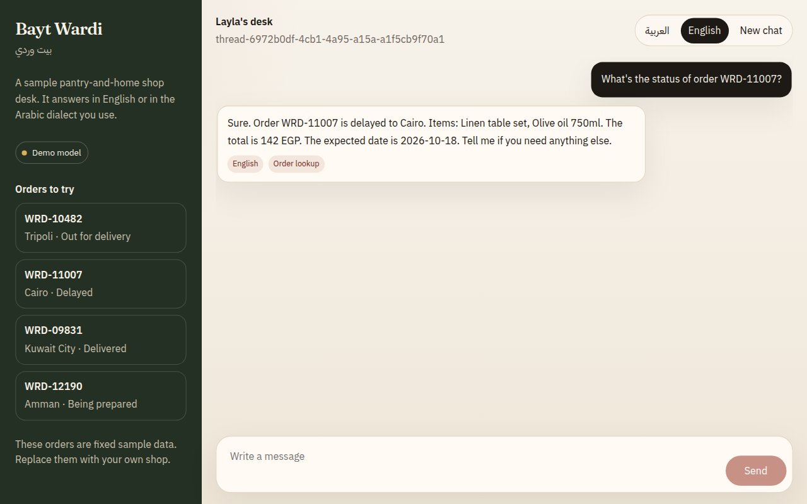
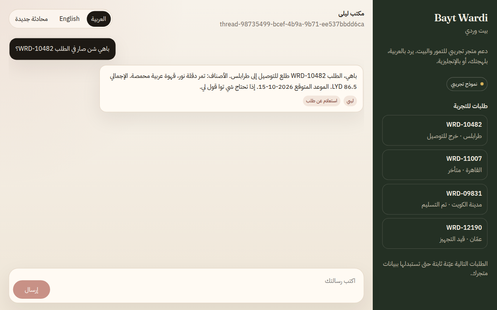
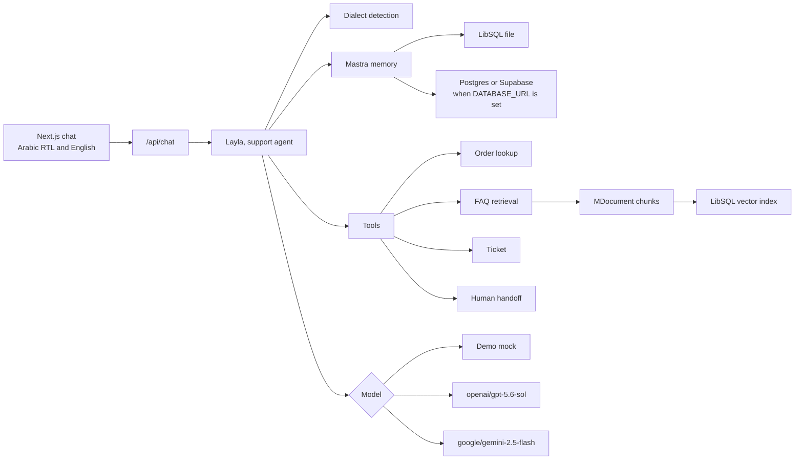

# Bayt Wardi support

A bilingual Arabic and English customer-support agent template built with [Mastra](https://mastra.ai). The sample shop, Bayt Wardi (بيت وردي), is fictional. Swap its orders, policies, and tone for your own business.

The agent notices whether a customer writes in Modern Standard Arabic, Libyan, Egyptian, Gulf, Levantine, or English, and answers in that same style. It can look up an order, retrieve a policy note, open a ticket, or hand the conversation to a person.

No API key is required. Demo mode uses a deterministic mock model, so the chat, the tests, and CI run offline.





## Architecture



| Piece | Where it lives |
| --- | --- |
| Agent, instructions, tools | `src/mastra` |
| Dialect detection and reply style | `src/mastra/dialect` |
| Sample orders | `src/mastra/data/orders.ts` |
| Policy notes and vector index | `src/mastra/knowledge` |
| Tickets and handoff queue | `src/mastra/data/tickets.ts` |
| Memory store | `src/mastra/memory` |
| Eval cases and scorers | `src/evals` |
| Chat UI | `src/app` and `src/components/support-chat.tsx` |

Conversation memory is Mastra `Memory` with the last 20 messages on a thread. The default database is a local LibSQL file (`file:./data/memory.db`). Set `DATABASE_URL` to a `postgres://` or `postgresql://` string, including a Supabase connection string, and the same memory switches to `PostgresStore`.

FAQ retrieval chunks each policy with `MDocument`, embeds it with a local hashing embedder, and queries `@mastra/libsql`'s vector store. The sample index does not call an embedding API. Tickets stay on their own LibSQL file so the demo still runs without Postgres.

## Run the demo

```bash
npm install
npm run dev
```

Open http://localhost:3000. The desk starts in Arabic, right to left. Switch the chrome to English with the toggle. The direction of each bubble follows the message itself.

Try a sample order id:

- `WRD-10482` Tripoli, out for delivery
- `WRD-11007` Cairo, delayed
- `WRD-09831` Kuwait City, delivered
- `WRD-12190` Amman, being prepared

Or ask in a dialect:

- ليبي: `باهي شن صار في الطلب WRD-10482؟`
- مصري: `التوصيل بياخد قد إيه؟`
- خليجي: `أبغى أكلم موظف الحين`
- فصحى: `أود معرفة سياسة الإرجاع`

## Models

| `SUPPORT_MODEL_MODE` | What runs |
| --- | --- |
| unset, and no key | Deterministic mock |
| `mock` | Deterministic mock, even if a key is present |
| `openai`, or `OPENAI_API_KEY` is set | `openai/gpt-5.6-sol` |
| `google`, or `GOOGLE_GENERATIVE_AI_API_KEY` / `GOOGLE_API_KEY` is set | `google/gemini-2.5-flash` |

When both keys exist and the mode is unset, OpenAI is used. Copy `.env.example` to `.env.local` for Next.js.

The mock plans a tool call from the customer message, then writes the reply only from that tool result, in the detected dialect. A real model receives the same instructions and the same tools. Keep the mock's cases in `src/evals/dataset.ts` when you change the policy, and run the suite before you trust a new prompt.

## Evals

`npm test` runs unit tests and the eval suite. No key is required.

Twelve cases cover MSA, Libyan, Egyptian, Gulf, Levantine, and English. Three programmatic scorers grade each reply:

- **language-match** checks the script and a dialect marker, and checks that an MSA reply does not slip into a regional marker
- **tool-choice** checks the tool that actually ran, or that a greeting called none
- **answer-faithfulness** checks that the reply includes the order id, amount, or policy sentence from the tool, and does not cite an invented order

```bash
npm test
npm run typecheck
```

## Adapt it to your business

1. Replace `SAMPLE_ORDERS` in `src/mastra/data/orders.ts`. Point `lookupOrder` at your order API and keep the returned fields the reply is allowed to mention.
2. Rewrite `FAQ_ARTICLES` in `src/mastra/knowledge/articles.ts`. Each note has an Arabic answer, an English answer, and keywords that include the way customers ask. The index rebuilds when the process starts.
3. Edit `supportInstructions` so the real model knows your brand, your refund rules, and what it must never invent.
4. Add dialect markers in `src/mastra/dialect/detect.ts` if you serve another variety. The reply closers in `src/mastra/dialect/reply.ts` are what the mock uses to stay in style. Update both together, then extend `src/evals/dataset.ts`.
5. For hosted memory, set `DATABASE_URL` to Postgres or Supabase. FAQ vectors and tickets stay local until you move those tools. To use hosted vectors, construct `PgVector` from `@mastra/pg` beside the existing `LibSQLVector` in `src/mastra/knowledge/faq-index.ts`.
6. For production answers, set `OPENAI_API_KEY` or `GOOGLE_GENERATIVE_AI_API_KEY`. Leave demo mode available for CI.
7. Semantic recall is off so memory does not need an embedding provider. To turn it on, pass a `vector` and an `embedder` into `Memory` in `src/mastra/memory/create-memory.ts`. `@mastra/fastembed` works offline. `ModelRouterEmbeddingModel` from `@mastra/core/llm` works when you already have a provider key.

## Scripts

| Command | Purpose |
| --- | --- |
| `npm run dev` | Next.js chat |
| `npm test` | Unit tests and dialect evals |
| `npm run typecheck` | `tsc --noEmit` |
| `npm run build` | Production build |

GitHub Actions runs typecheck, tests, and the production build on Node 22.

## License

MIT. Copyright (c) 2026 Maeen Alganimi.
